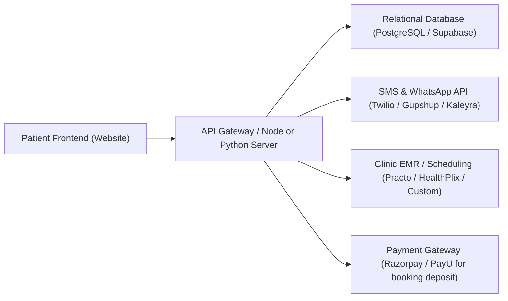

# CarePlus Multispeciality Clinic — Premium Healthcare Website Demo
> **Crafted by GrowthCraft Studio**  
> *A high-converting, accessible, and modern digital healthcare experience for multispeciality clinics and healthcare leaders.*

---

## 🏥 Project Overview

**CarePlus Multispeciality Clinic** is a modern, responsive, and patient-focused healthcare website prototype designed to demonstrate the quality, performance, and conversion architecture offered by **GrowthCraft Studio**.

The demonstration embodies the digital presence of an established private multispeciality clinic located in **Hubballi, Karnataka, India**. It provides patients with zero-friction appointment booking, transparent physician credentials, department overviews, bilingual Karnataka regional support, and simulated local clinic logistics.

> [!NOTE]
> **Fictional Demonstration Notice:**  
> All doctor profiles, medical credentials, patient reviews, addresses, and telephone numbers featured on this website are fictional demo simulations. No actual medical consultations are scheduled or medical records stored.

---

## ✨ Key Highlights & Features

### 1. 🌟 Best-in-Segment 6-Step Appointment Booking Engine
- **Step 1: Department Selection** — Visual department cards with instant filtering.
- **Step 2: Doctor Selection** — Doctor photo, credentials, consultation fee preview, and availability status.
- **Step 3: Interactive Calendar** — Real-time month navigation, disabling past dates, doctor off-day rules (e.g., Sunday off or custom clinic days), and 30-day booking horizon.
- **Step 4: Dynamic Time Slots** — Categorized by Morning, Afternoon, and Evening slots. Displays **Available**, **Fast Filling (1 left)**, and **Booked / Unavailable** states. Enforces real-time duplicate slot prevention.
- **Step 5: Patient Particulars Form** — Validated Indian mobile number formatting (`+91`), New vs. Returning patient classification, preferred reminder channel (WhatsApp / SMS / Phone Call), and reason for visit.
- **Step 6: Review & Finalize** — Full consultation fee and booking summary with demo disclaimer consent.
- **Instant Digital Confirmation** — Generates a unique booking reference (e.g., `CP-HUB-2026-4821`), downloadable `.ics` calendar file, and a formatted printable medical appointment pass.
- **"My Bookings" Local Management** — Local storage lookup allowing prospective clients to test viewing, rescheduling, or canceling demo appointments without page refresh.

### 2. 🩺 Comprehensive Multispeciality Departments
- **General Medicine & Diabetology** — Adult chronic illness, diabetes control, and seasonal infections.
- **Pediatrics & Child Care** — Infant care, IAP immunization schedules, and childhood asthma care.
- **Dermatology & Skin Care** — Clinical dermatosis, acne scar protocols, and hair fall therapies.
- **Gynecology & Women's Health** — Antenatal maternity monitoring, PCOS/PCOD care, and cancer screenings.
- **Preventive Health Checkups** — Annual master health screening, senior citizen cardiac profiles, and executive physicals.
- *Interactive "View Treatments" modal for every department.*

### 3. 👨‍⚕️ Interactive Doctor Directory
- 5 comprehensive doctor profiles with high-resolution portraits, qualifications, clinical focus, consultation hours, and consultation fees.
- **Live Search & Filter** by department, doctor name, or symptoms (e.g., "fever", "skin", "child", "PCOS").
- **Doctor Profile Modal** with detailed medical education history, areas of expertise, and one-click direct appointment booking.

### 4. 🇮🇳 Karnataka Bilingual Readiness (Kannada Preview)
- Header language toggle demonstrating regional accessibility (`ಕನ್ನಡ Preview`), showing Kannada taglines, clinic headings, and department names (`ಜನರಲ್ ಮೆಡಿಸಿನ್`, `ಮಕ್ಕಳ ಚಿಕಿತ್ಸೆ`, `ಚರ್ಮ ರೋಗ ಚಿಕಿತ್ಸೆ`, etc.) to demonstrate readiness for Karnataka healthcare clients.

### 5. 📍 Hubballi Location & Directions Hub
- Embedded Google Maps preview centered on **Shirur Park Main Road, Vidyanagar, Hubballi**.
- Proximity matrix calculating travel time and distance from key landmarks (KLE Tech / BVB College, KIMS Hospital corridor, Hubballi Railway Station).
- Demo 24/7 emergency dispatch helpline simulation.

### 6. 📱 Mobile-First Responsive UX
- Sticky header with scroll-spy and quick "Book Appointment" CTA.
- Slide-over mobile drawer navigation.
- Native-like mobile bottom navigation bar for quick thumb-reach access (Home, Doctors, Book Now, My Bookings).
- Floating WhatsApp and Click-to-Call buttons.

---

## 📁 Project Structure

```
careplus-clinic-demo/
│
├── index.html                  # Core HTML5 application with semantic accessible markup
├── start-server.ps1            # Native PowerShell HTTP server (zero dependencies needed)
├── README.md                   # Complete documentation and GrowthCraft client pitch guide
│
├── css/
│   ├── main.css                # Visual theme, typography, components, animations, and responsive layout
│   └── booking.css             # Specialized stylesheet for the 6-step booking engine, calendar & slip
│
├── js/
│   ├── data.js                 # Structured mock data: clinic info, doctors, specialities, faqs, reviews
│   ├── booking.js              # Booking wizard state machine, calendar builder, slot validation & localStorage
│   ├── map-demo.js             # Interactive location, landmark travel times, directions trigger
│   └── main.js                 # Global controller: sticky nav, modals, filters, toasts, language switcher
│
```

---

## 🚀 How to Run Locally

### Option 1: Direct Browser Launch (Simplest & Instant)
No server, runtime, or installation required!
1. Download or clone this repository and open its folder.
2. Double-click **`index.html`** to open it directly in Google Chrome, Microsoft Edge, Mozilla Firefox, or Safari.
3. All interactive features, booking animations, calendar selections, and modal views work immediately.

### Option 2: Local HTTP Server via PowerShell
If you prefer running via `http://localhost:8080`:
1. Open PowerShell and run:
   ```powershell
   cd path\to\careplus-clinic-demo
   .\start-server.ps1
   ```
2. The script will automatically launch your default browser to `http://localhost:8080/`.
3. Press `Ctrl + C` in the PowerShell window to stop the server when finished.

---

## 🛠️ Architecture & Technical Implementation

| Aspect | Technology & Approach | Benefit |
| :--- | :--- | :--- |
| **Markup** | Semantic HTML5 (ARIA landmarks, dialog roles, accessible forms) | Superior SEO crawlability and screen-reader accessibility. |
| **Styling** | Modern CSS3 (Variables, CSS Grid, Flexbox, backdrop-filter, print styles) | Lightweight, ultra-fast load time with zero layout shift (CLS < 0.05). |
| **Utilities** | Tailwind CSS CDN (v3.4) | Rapid consistency for spacing, typography, and color tokens. |
| **Scripting** | Vanilla ES6+ Modular Classes (`BookingEngine`, `AppController`, `ClinicMapManager`) | Zero bundle overhead, no Node/build step required, instant local execution. |
| **Persistence** | Browser `localStorage` (`careplus_demo_bookings`) | Enables realistic multi-session booking testing, cancellation, and duplicate prevention. |
| **Print Output** | Native `@media print` styling | Generates clean, printer-friendly doctor consultation slips without page clutter. |
| **Calendar Sync** | Dynamic `.ics` iCalendar Generator (Blob RFC 5545) | Allows patients to save appointments directly to Apple Calendar, Google Calendar, or Outlook. |

---

## 🔌 Production Roadmap: Backend Integration Requirements

To transition this high-fidelity demonstration into a live, production-grade clinical platform for a real clinic client, GrowthCraft Studio would integrate the following backend infrastructure:



### 1. Database & Scheduling Engine
- **Relational Database**: PostgreSQL or Supabase to store patient records, physician rosters, consultation slots, buffer intervals (e.g. 15-min breaks), and booking states.
- **Concurrency Locking**: Atomic database transactions (e.g. `SELECT FOR UPDATE`) to prevent simultaneous double-booking of a single physician slot by two concurrent website visitors.

### 2. Multi-Channel Notification Gateway
- **WhatsApp Business API**: Automated booking confirmation with clinic location pin, pre-consultation fasting guidelines, and 2-hour appointment reminders.
- **SMS Gateway**: DLT-registered transactional SMS templates (complying with TRAI guidelines in India) via Gupshup, Exotel, or Kaleyra.
- **Email Service**: SendGrid or AWS SES for sending branded PDF appointment confirmation receipts.

### 3. Payment Gateway (Optional Consultation Deposit)
- Integration with **Razorpay** or **PayU** to support optional advance consultation fee collection or token reservation fees to reduce patient no-shows.

### 4. Clinic Management / EMR System Integration
- Bidirectional webhook synchronization with clinic EHR/EMR platforms (such as Practo Ray, HealthPlix, or custom hospital information management systems) to sync doctor leave days, emergency block-outs, and live OPD queues.

### 5. Regulatory Compliance & Data Safeguards
- Compliance with India's **Digital Personal Data Protection Act (DPDP 2023)** and **National Digital Health Mission (ABDM/NDHM)** standards.
- End-to-end TLS encryption for all patient phone numbers and consultation reasons.
- Strict medical data disclaimers clarifying that website booking forms do not constitute emergency triage or telemedicine prescriptions.

---

## 💼 GrowthCraft Studio Client Pitch Guide

When presenting this demo website to prospective clinic owners, hospital directors, and private practitioners, emphasize the following strategic advantages:

1. **Patient Conversion Over Generic Web Design**:
   - Most clinic websites are static brochures with non-functional "contact us" forms that lose prospective patients. CarePlus provides an intuitive, frictionless 6-step appointment funnel that converts website traffic into confirmed clinic footfalls.
2. **Reduced Clinic Front-Desk Workload**:
   - Automated digital slot scheduling dramatically lowers the volume of phone inquiries receptionists must handle each morning, eliminating booking mistakes and double bookings.
3. **Professional Brand Prestige**:
   - A clean, modern aesthetic with high-fidelity typography, verified doctor credentials, and transparent clinic timings positions the clinic as a trustworthy, premium healthcare provider.
4. **Local SEO & Discovery**:
   - Structured JSON-LD / schema-ready headings and Hubballi-specific geographical metadata ensure the clinic ranks prominently for local searches such as *"best pediatrician in Hubballi"* or *"general physician near Vidyanagar"*.
5. **Turnkey Delivery by GrowthCraft Studio**:
   - GrowthCraft Studio handles end-to-end design, custom branding, physician photography art direction, domain setup, hosting, and optional clinic software integration.

---

*© 2026 GrowthCraft Studio. All rights reserved.*
